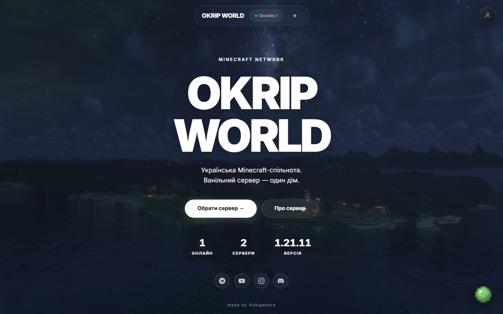

# Okrip World

[](https://github.com/BlackMfgik/okrip-world/actions/workflows/ci.yml)

🌐 **Live:** [okrip.world](https://okrip.world) · **Type:** paid client project

Website and player verification system for a Ukrainian Minecraft network (3 servers), built for a client.
Players sign in with Discord, submit an application with their Minecraft nickname, moderators review it in Telegram,
and approved players are automatically whitelisted on the game server.



**Stack:** Next.js · Fastify · PostgreSQL · Drizzle · Zod · Turborepo · Java 21 (Paper plugin) · Vitest · Docker · GitHub Actions

## Features

- Turborepo monorepo: Next.js web app, Fastify API with a background worker, shared Zod contracts
- Discord OAuth sign-in and a player application flow with moderation in Telegram
- Java plugin with retry-based command delivery, so approved players are never lost between services
- Live Dynmap world maps through a server-side proxy
- CI: typecheck, lint, Vitest tests on real PostgreSQL, build

See [architecture and module boundaries](docs/ARCHITECTURE.md) for code ownership, transaction rules, and frontend organization.

## Getting started

Requirements: Node.js, pnpm, Docker.

```bash
pnpm install
docker compose up -d          # local PostgreSQL
cp .env.example .env          # fill in Discord / Telegram credentials
pnpm db:migrate
pnpm dev                      # web on :3000, API on :3001
```

Checks: `pnpm typecheck`, `pnpm lint`, `pnpm test`.
